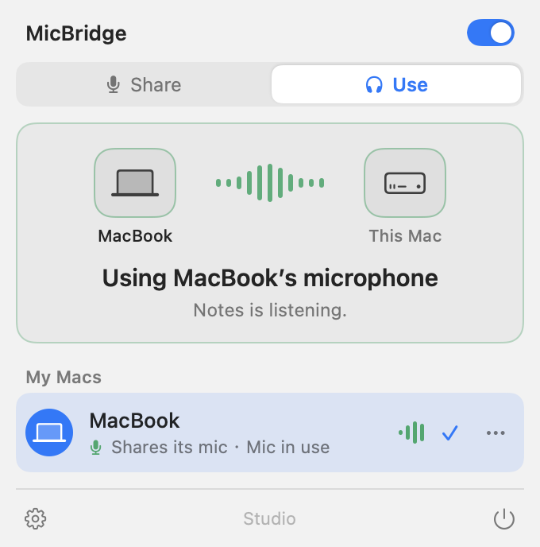
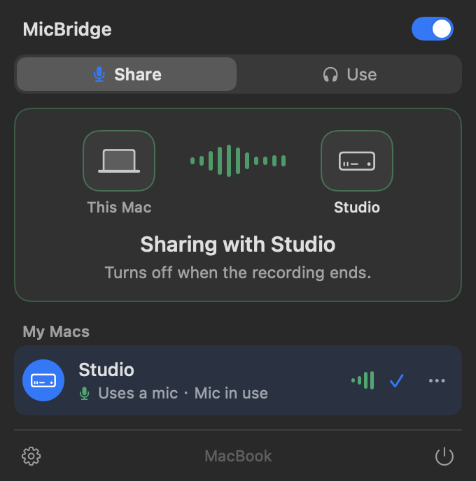
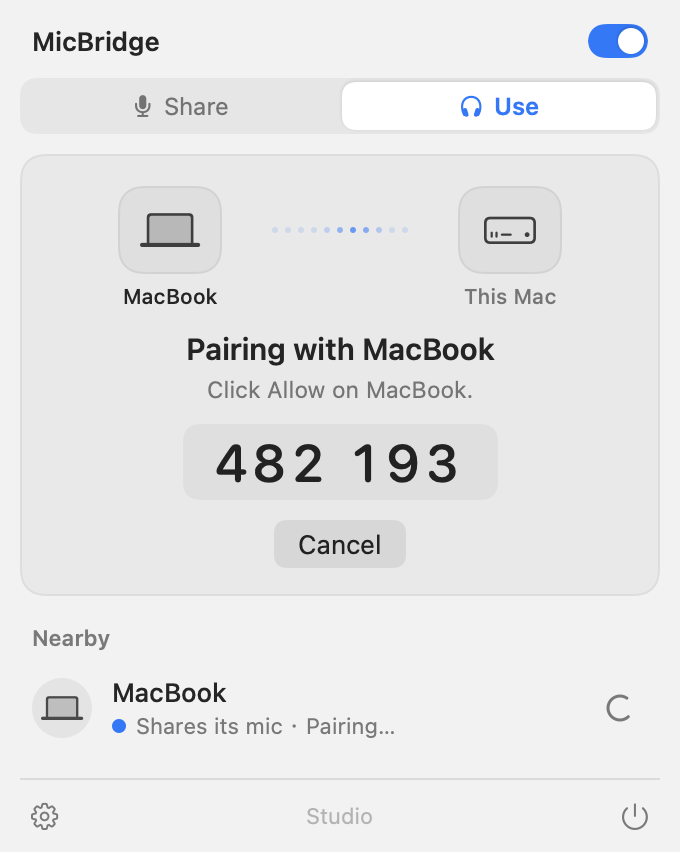
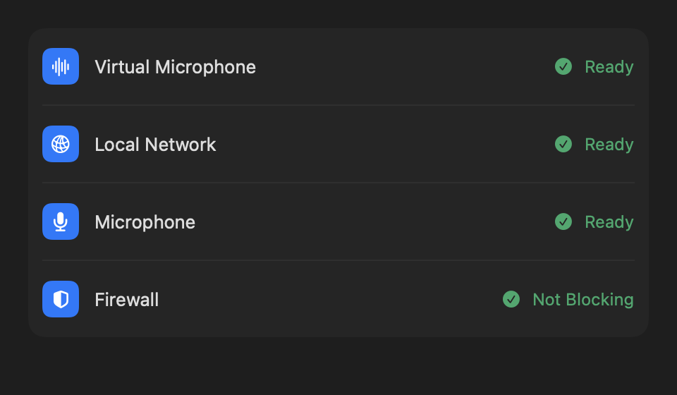

English | [简体中文](README.zh-CN.md)

# MicBridge

MicBridge lets one Mac use another Mac's microphone. Run it on both Macs: one shares its microphone, the other uses it. On the Mac that uses it, apps record from a virtual microphone called **MicBridge Microphone**, and what they hear comes from the other Mac, live, over your local network.

It is a small menu bar app written in Swift (AppKit + SwiftUI), with no third-party dependencies.

<p>
  
  
</p>

## Features

- **Two roles**: *Share* this Mac's microphone, or *Use* another Mac's. A switch in the panel pauses everything.
- **Only when needed**: the shared microphone turns on when an app on the other Mac starts recording, and off again when it stops.
- **Finds Macs nearby**: Macs running MicBridge on the same network show up on their own (Bonjour). No addresses to type.
- **Pair once with a code**: both Macs show the same 6-digit code; confirm on the other Mac and they remember each other. Several Macs can be paired, and Macs with the same name are told apart.
- **Encrypted**: everything between the two Macs is encrypted with keys exchanged when they pair.
- **Its own virtual microphone**: the MicBridge Microphone driver is built in and installed from the app with one click.
- **Languages**: English and Simplified Chinese, following the system language.

<p>
  
  
</p>

## Requirements

- Two Macs with Apple silicon, running macOS 15 or later
- Both on the same local network (Wi-Fi or Ethernet), with clocks set automatically (messages more than a minute old are rejected)
- To build: Xcode or the Xcode Command Line Tools (`swiftc`, `clang`)

## Install

There are no prebuilt downloads yet; build the app from source (below), then on **each** Mac:

1. Copy `MicBridge.app` to `/Applications` and open it. It lives in the menu bar.
2. Choose a role: *Share* on the Mac whose microphone you want to use, *Use* on the other.
3. On the Mac that uses the microphone, install **MicBridge Microphone** when asked (or later in Settings › Permissions).
4. In the panel, pick the other Mac under *Nearby*, check that both Macs show the same code, and click *Allow* on the other Mac.
5. While the two Macs are connected, MicBridge Microphone is the default input, like AirPods; the previous input comes back when they disconnect. Apps that pick their own microphone can choose **MicBridge Microphone** themselves.

## Build from source

From a clone of this repository:

```sh
./build.sh --adhoc                          # ad-hoc signed MicBridge.app
MicBridge.app/Contents/MacOS/MicBridge --self-test
```

`build.sh` uses `swiftc` and `clang` directly; there is no Xcode project. It builds the app and the driver into `MicBridge.app` and installs nothing.

To sign with your own certificate, set `MICBRIDGE_SIGN_IDENTITY` to its name (list yours with `security find-identity -v -p codesigning`):

```sh
MICBRIDGE_SIGN_IDENTITY="Apple Development: Your Name (TEAMID1234)" ./build.sh
```

An ad-hoc build works, but macOS treats every one as a new app, so it may ask again for Microphone, Local Network and keychain access after you rebuild. A stable signing identity avoids that.

`--self-test` runs the unit and loopback tests in-process: encryption, pairing, the wire format, the panel's states, and the driver loaded into the test process. It stays on this Mac (loopback connections only) and needs no permissions or administrator rights.

### Release builds

Releases are signed with a Developer ID Application certificate, use the hardened runtime and are notarized:

```sh
./build.sh --notarize      # sign, notarize and staple; writes build/MicBridge-<version>-macOS-arm64.{zip,dmg} and .sha256
./build.sh --package       # the same archives, without notarizing
```

Without `MICBRIDGE_SIGN_IDENTITY`, `build.sh` uses the Developer ID Application identity of `MICBRIDGE_TEAM_ID` if the keychain has one, and signs ad-hoc otherwise. Notarizing uses the notarytool keychain profile named by `MICBRIDGE_NOTARY_PROFILE` (create one with `xcrun notarytool store-credentials`). A build whose binaries contain a `/Users/` path is refused. Run `./build.sh --help` for every option.

## Permissions

| | Who needs it | Why |
|---|---|---|
| Microphone | The sharing Mac | To capture the sound it sends. It is only on while the other Mac is recording. |
| Local Network | Both Macs | To find each other and connect. macOS asks the first time. |
| Firewall | Both Macs | If the macOS firewall blocks incoming connections, MicBridge says so and links to the settings. It only reads the firewall's state and never changes it. |
| Virtual microphone driver | The using Mac | Installing it copies MicBridge Microphone to `/Library/Audio/Plug-Ins/HAL` and restarts Core Audio, so macOS asks for an administrator password and sound pauses for a few seconds. MicBridge always asks before it starts. |
| Keychain | Both Macs | The pairing keys are kept in your login keychain. |

See [Driver/README.md](Driver/README.md) for how the driver works and how to install or remove it by hand.

## Privacy

- MicBridge only talks to your other Macs on the local network. It has no server, account, analytics or crash reporting, and never connects to the internet.
- Everything sent between the two Macs, sound included, is encrypted with AES-GCM. The keys are exchanged once, when the Macs pair, over a Curve25519 key agreement that the 6-digit code confirms. They are kept in each Mac's keychain.
- Nothing is recorded or saved. The microphone is on only while an app on the other Mac is recording.

## License

[Apache License 2.0](LICENSE)
