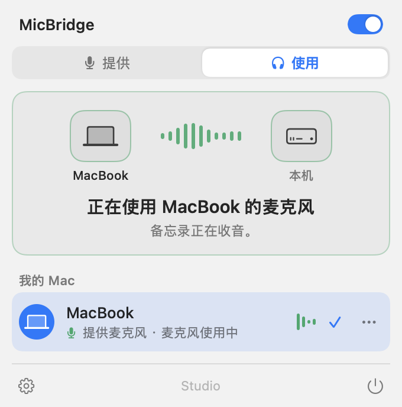
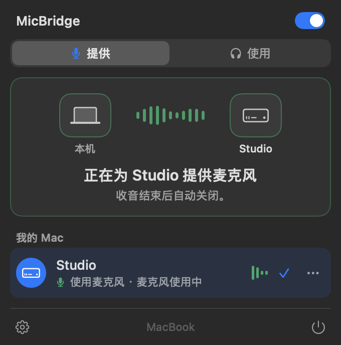
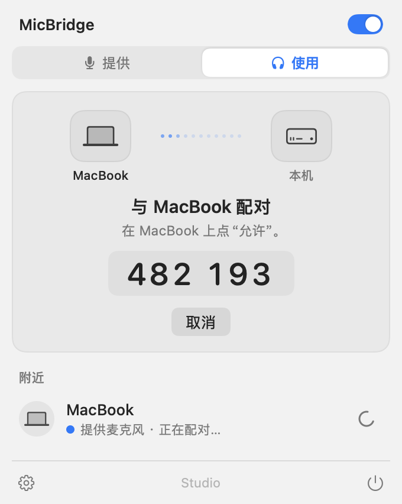
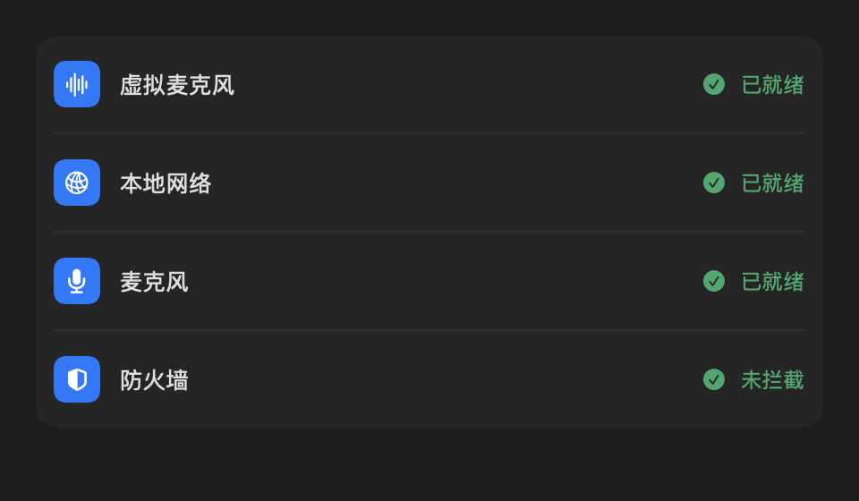

[English](README.md) | 简体中文

# MicBridge

MicBridge 让一台 Mac 借用另一台 Mac 的麦克风。两台 Mac 都运行它：一台提供麦克风，另一台使用。在使用的那台上，应用从名为 **MicBridge Microphone** 的虚拟麦克风收音，声音经局域网实时来自另一台 Mac。

它是一个用 Swift（AppKit + SwiftUI）写的菜单栏小工具，没有第三方依赖。

<p>
  
  
</p>

## 功能

- **两种角色**：*提供*本机的麦克风，或*使用*另一台 Mac 的麦克风。面板上的开关可以随时暂停。
- **用时才开**：另一台 Mac 上有应用开始收音时，才打开提供方的麦克风，收音结束就关闭。
- **自动发现**：同一网络里运行 MicBridge 的 Mac 会自动出现（Bonjour），不用输入地址。
- **6 位码配对**：两台 Mac 显示同一个 6 位码，在另一台上点“允许”后互相记住。可以配对多台；同名的 Mac 也能区分。
- **加密传输**：两台 Mac 之间的所有内容都用配对时交换的密钥加密。
- **自带虚拟麦克风**：内置 MicBridge Microphone 驱动，在 App 里点一下即可安装。
- **语言**：简体中文和英文，跟随系统语言。

<p>
  
  
</p>

## 系统要求

- 两台 Apple 芯片的 Mac，macOS 15 或更高版本
- 在同一个局域网（Wi-Fi 或有线），系统时间自动设置（超过一分钟的消息会被拒绝）
- 从源码构建需要 Xcode 或 Xcode Command Line Tools（`swiftc`、`clang`）

## 安装

目前还没有预编译的下载，请先按下文从源码构建，然后在**两台** Mac 上：

1. 把 `MicBridge.app` 拷到“应用程序”并打开，它在菜单栏里。
2. 选择角色：要借出麦克风的那台选*提供*，另一台选*使用*。
3. 在使用方 Mac 上按提示安装 **MicBridge Microphone**（也可以之后在 设置 › 权限 里安装）。
4. 在面板的*附近*里选中另一台 Mac，确认两边显示的码一致，然后在另一台上点*允许*。
5. 两台 Mac 连接期间，MicBridge Microphone 会像 AirPods 一样成为默认输入，断开后恢复原来的输入。自己选择麦克风的应用，可在其中选 **MicBridge Microphone**。

## 从源码构建

在本仓库的目录里：

```sh
./build.sh --adhoc                          # ad-hoc 签名的 MicBridge.app
MicBridge.app/Contents/MacOS/MicBridge --self-test
```

`build.sh` 直接调用 `swiftc` 和 `clang`，没有 Xcode 工程。它把 App 和驱动构建进 `MicBridge.app`，不安装任何东西。

要用自己的证书签名，把 `MICBRIDGE_SIGN_IDENTITY` 设为证书名称（可用 `security find-identity -v -p codesigning` 查看）：

```sh
MICBRIDGE_SIGN_IDENTITY="Apple Development: Your Name (TEAMID1234)" ./build.sh
```

ad-hoc 签名的构建也能正常运行；但 macOS 会把每次 ad-hoc 构建都当成新的 App，重新构建后可能再次询问麦克风、本地网络和钥匙串权限。用固定的签名身份可以避免。

`--self-test` 在进程内运行单元测试和回环测试：加密、配对、传输格式、面板的各种状态，以及加载进测试进程的驱动。只在本机进行（仅回环连接），不需要任何权限或管理员密码。

### 发布构建

发布版使用 Developer ID Application 证书签名，启用 hardened runtime 并经过公证：

```sh
./build.sh --notarize      # 签名、公证并 staple；生成 build/MicBridge-<版本>-macOS-arm64.{zip,dmg} 及 .sha256
./build.sh --package       # 生成同样的压缩包，但不公证
```

不设 `MICBRIDGE_SIGN_IDENTITY` 时，`build.sh` 会使用钥匙串里 `MICBRIDGE_TEAM_ID` 团队的 Developer ID Application 身份；没有则用 ad-hoc 签名。公证使用 `MICBRIDGE_NOTARY_PROFILE` 指定的 notarytool 钥匙串配置（用 `xcrun notarytool store-credentials` 创建）。二进制里含有 `/Users/` 路径的构建会被拒绝。全部选项见 `./build.sh --help`。

## 权限

| | 谁需要 | 用途 |
|---|---|---|
| 麦克风 | 提供方 | 采集要发送的声音，只在另一台 Mac 收音时打开。 |
| 本地网络 | 两台都要 | 互相发现和连接，macOS 第一次会询问。 |
| 防火墙 | 两台都要 | macOS 防火墙拦截传入连接时，MicBridge 会提示并给出设置入口。只读取防火墙状态，从不更改。 |
| 虚拟麦克风驱动 | 使用方 | 安装时会把 MicBridge Microphone 拷到 `/Library/Audio/Plug-Ins/HAL` 并重启 Core Audio，因此 macOS 会要求管理员密码，声音会中断几秒。MicBridge 每次都会先征得你的同意。 |
| 钥匙串 | 两台都要 | 配对密钥保存在登录钥匙串里。 |

驱动的工作方式，以及如何手动安装、卸载，见 [Driver/README.md](Driver/README.md)（英文）。

## 隐私

- MicBridge 只在局域网内和你自己的 Mac 通信。没有服务器、账户、统计或崩溃上报，从不连接互联网。
- 两台 Mac 之间发送的所有内容（包括声音）都用 AES-GCM 加密。密钥只在配对时交换一次，通过 Curve25519 密钥协商并由 6 位码确认，保存在各自的钥匙串里。
- 不录音，也不保存任何声音。麦克风只在另一台 Mac 上有应用收音时打开。

## 许可证

[Apache License 2.0](LICENSE)
